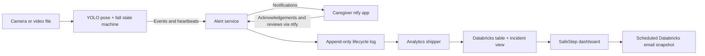

# SafeStep

SafeStep is a camera-based fall monitoring prototype. It detects rapid drops followed by a lying posture, notifies caregivers through ntfy, and records incident history for a Databricks dashboard and scheduled email snapshots.

The detector lives in `safestep/`. The obsolete `EdgeDetection/` placeholder has been removed.

## System overview



The alert service operates independently of Databricks. The detector and alert service must remain running for monitoring; the shipper must run for fresh dashboard data. The email job runs in Databricks.

## Documentation

| Guide | Contents |
| --- | --- |
| [Architecture and event lifecycle](docs/architecture.md) | Components, payloads, state transitions, persistence, and metric definitions |
| [Operating guide](docs/operations.md) | Installation, startup, configuration, shutdown, troubleshooting, and tests |
| [Verification status](docs/verification.md) | User-confirmed deployment status, automated checks, and remaining limits |
| [Detector](safestep/README.md) | Camera options, thresholds, evidence score, and Python integration |
| [Alerts](alerts/README.md) | ntfy configuration, HTTP API, acknowledgements, and caregiver reviews |
| [Analytics](analytics/README.md) | Databricks initialization, ingestion, recovery, and synthetic demo data |
| [Dashboard](analytics/dashboard/README.md) | Importing, publishing, and dashboard data sources |
| [Active email delivery](analytics/databricks/README.md) | Native Databricks snapshot job, schedule, and subscribers |
| [Optional custom digest](analytics/reports/README.md) | HTML/text reports, SMTP delivery, and delivery ledgers |

## Quick start

Use Python 3.10+ and `uv`. From the repository root:

```sh
uv sync
# Terminal 1: print notifications for an initial local check.
uv run python alerts/alert_service.py --dry-run
# Terminal 2: process a camera and send events to the local alert service.
uv run safestep --source 0 --device-id uno_q_01 --room "Living room"
```

The first alert-service run creates private `alerts/config.json`. Configure the ntfy topic and subscribe on the caregiver's phone, then restart without `--dry-run` for real notifications. Set matching API keys when authentication is enabled. Follow the [operating guide](docs/operations.md) to start analytics and configure email.

For a camera-free alert demo, run `uv run python alerts/simulate_engine.py demo` while the alert service is running. The simulator uses the legacy client and does not automatically read the detector's API-key environment variable.

## Repository layout

| Path | Responsibility |
| --- | --- |
| `safestep/` | Camera loop, YOLO pose tracking, fall detection, serialization, HTTP worker, overlays |
| `alerts/` | Standalone HTTP alert service, ntfy delivery, simulator, legacy client, contract |
| `analytics/` | Lifecycle ingestion, demo generation, weekly report and deployment scripts |
| `analytics/sql/` | Delta table, incident view, example dashboard queries |
| `analytics/dashboard/` | Exported dashboard definition |
| `analytics/databricks/` | Hosted report notebook and email deployment documentation |
| `tests/`, `alerts/tests/`, `analytics/tests/` | Detector/integration, alert-service, and analytics tests |
| `docs/` | System architecture, operating procedures, verification record |
| `pyproject.toml`, `uv.lock` | Detector dependencies and reproducible project environment |

## Tests

```sh
uv run pytest tests -q
python3 -m unittest discover -s alerts/tests -v
python3 -m unittest discover -s analytics/tests -v
```

Detector tests use synthetic poses; they do not establish accuracy on real falls. SafeStep is a research prototype, not a certified emergency system.
